<p align="center">
  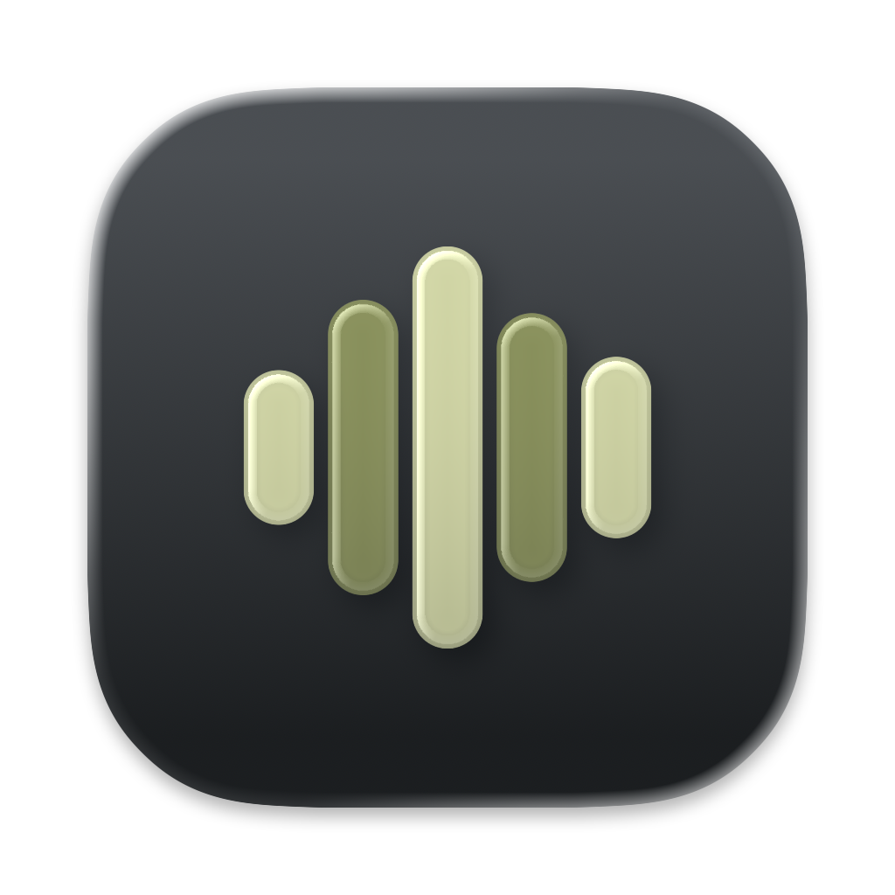
</p>

<h1 align="center">Murmur</h1>

<p align="center">
  Hold a key, say it, let go. Your words appear where your cursor is.
</p>

<p align="center">
  <a href="https://github.com/0-LY/murmur/releases/latest/download/Murmur.dmg"><b>Download Murmur for macOS</b></a>
  ·
  <a href="https://github.com/0-LY/murmur/releases">All releases</a>
</p>

<p align="center">
  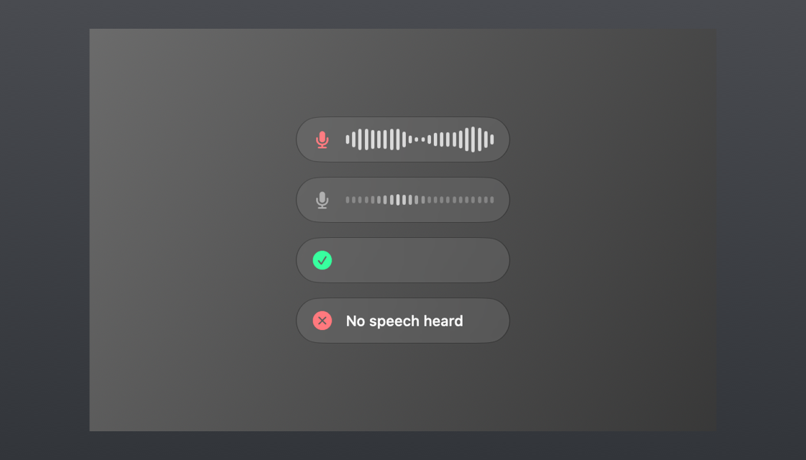
</p>

## What it does

Hold **Right ⌥** and talk. Let go, and the cleaned-up text appears in the app you're in — a chat, an email, a
document, a code editor. Everything happens on your Mac.

- **Talk key:** hold Right ⌥ (default), hold 🌐 fn, double-tap Right ⌘, or record any shortcut of your own.
  Hold to talk, or switch to press-to-start, press-to-stop. A quick tap also starts listening; tap again to stop. Esc cancels.
- **Final only** (the default) pastes the cleaned text when you let go. **Live typing** types the words as you speak
  instead; only words the model is sure of are typed, so nothing is ever deleted and retyped. Switch in
  **Settings → Writing**. Whisper Turbo always pastes the final result.
- **Spoken punctuation** (on by default): say “comma”, “question mark”, “colon”, “new line” or “new paragraph” — or «кома», «знак питання», «новий рядок» — and the symbol is typed. Words used as nouns ("the colon of the text") stay words.
- **Sounds:** start and stop sounds made for Murmur — Bubble (default), Deep or Soft — with a ▶ preview, five
  volume steps, and a choice of start, stop or both. Turn them off in **Settings → General**.
- **Four speech models.** Apple's built-in speech recognition is always there, nothing to download. Add up to three
  downloadable models in **Settings → Models** and switch between them instantly:

  | Model | Download | Best for |
  |---|---|---|
  | Apple | built in | Ready right away. English, Ukrainian and more |
  | Parakeet Ultra | ≈ 640 MB | Most accurate. 25 European languages, incl. English and Ukrainian |
  | Parakeet Redux | ≈ 220 MB | Smallest download, still accurate |
  | Whisper Turbo | ≈ 640 MB | Mixed languages and unusual names |

- **Models stay on your Mac** once downloaded, so switching is instant. **Free Up Space** removes one and keeps it in the list
  for a one-click download later; **Delete All Models** clears them. When your disk gets low, Murmur points out models
  you haven't used in 30 days — it never deletes anything on its own. If another app already downloaded the same model
  (FluidAudio or Hugging Face caches), Murmur checks it and makes an instant copy instead of downloading it again.
- **Microphone:** Murmur always uses your Mac's input from **System Settings → Sound** — plug in AirPods and it
  switches with the system. **Sound Settings…** and **Mic Mode…** (Voice Isolation for noisy rooms) open macOS's own
  controls. **Check Mic** listens to the room for 2 seconds, then to your voice, shows a live level bar and sets
  how quiet speech can be (for example "Room −55 dB · Voice −32 dB · ✓ Good"); fine-tune it with **Sensitivity**.
  **Test Recording** plays your sentence back, shows the
  waveform and the text, and rates it: Good, Too quiet, Too noisy or Clipping, with a tip. Silence before and after you
  talk is trimmed, and a muted mic is spotted right away.
- **Fast results:** Murmur transcribes while you talk — every pause finishes a piece in the background — so when you
  let go only the last few words are left. Text usually appears about 0.1–0.2 s after you release the key.
- **Focus on main voice** (experimental, off by default; you're asked to confirm when you turn it on): each time you
  talk, Murmur tells the voices apart with a small on-device speaker model (≈ 17 MB, CAM++ via FluidAudio,
  downloaded the first time) and drops other voices that are both different from yours and clearly quieter. A voice
  close to your loudness is never dropped, and it never removes more than 40 % of the speech. **Sensitivity**: Low
  (default) keeps the most, High drops more. Under 2 seconds of speech, or a single voice, is kept as it is.
- **Never writes its own sound:** the start sound is muted out of the recording, and a press with only "oh", "uh",
  "ну" or silence pastes nothing — the bubble says "No speech heard".
- **Cleanup** (Final only), in **Settings → Writing**: **Quick** (default, instant) fixes spacing, capitals, filler
  words ("um", "ну") and your vocabulary. **Smart** also lets Apple's on-device model fix wording; it waits at most
  1.5 s, then falls back to Quick. Neither translates or adds anything. **Off** pastes exactly what was heard.
- **Vocabulary:** names and words you want spelled exactly right — product names, colleagues, places.
- **Try It:** record a sentence or pick an audio file, and every downloaded model transcribes it with its time, side by side.
- **A glass bubble** just above the text field you're typing in: a microphone and a live waveform while you talk, a soft
  shimmer while it works, then ✓ — or a short reason like "No speech heard". It fades in and out softly, and keeps one size and one place from the
  moment you press the key, and the waveform stays flat while you're silent. Your words never show in it. Pick its size
  in **Settings → Animation**, with a live preview.

<p align="center">
  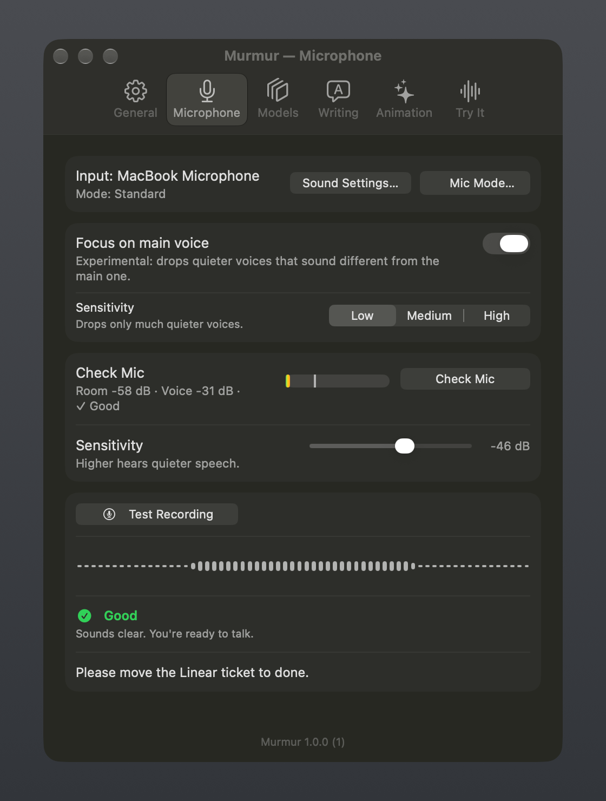
  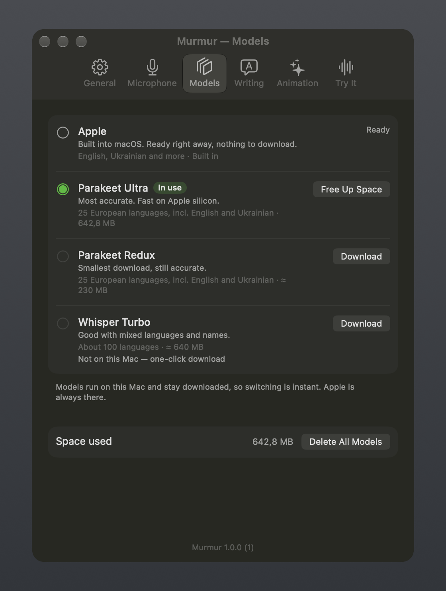
</p>
<p align="center">
  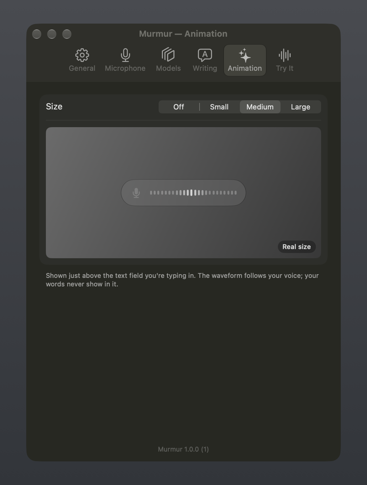
  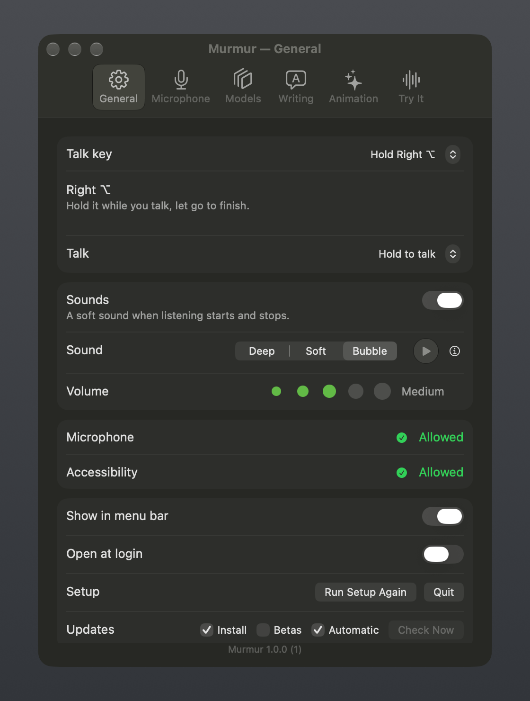
</p>
<p align="center">
  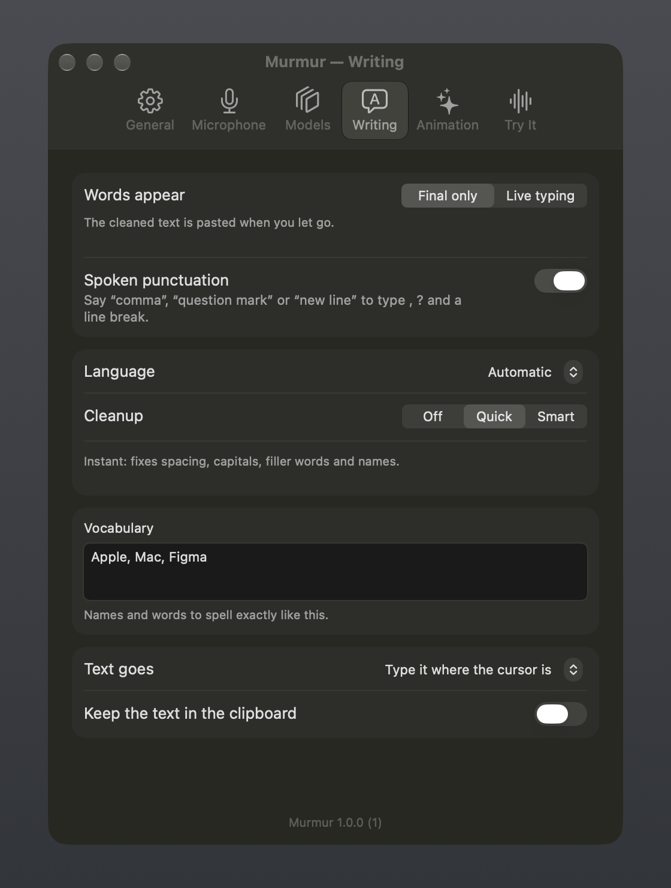
  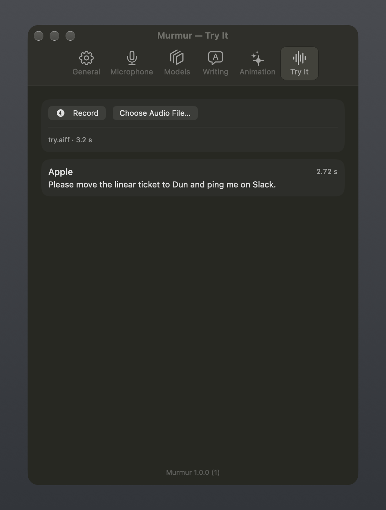
</p>
<p align="center">
  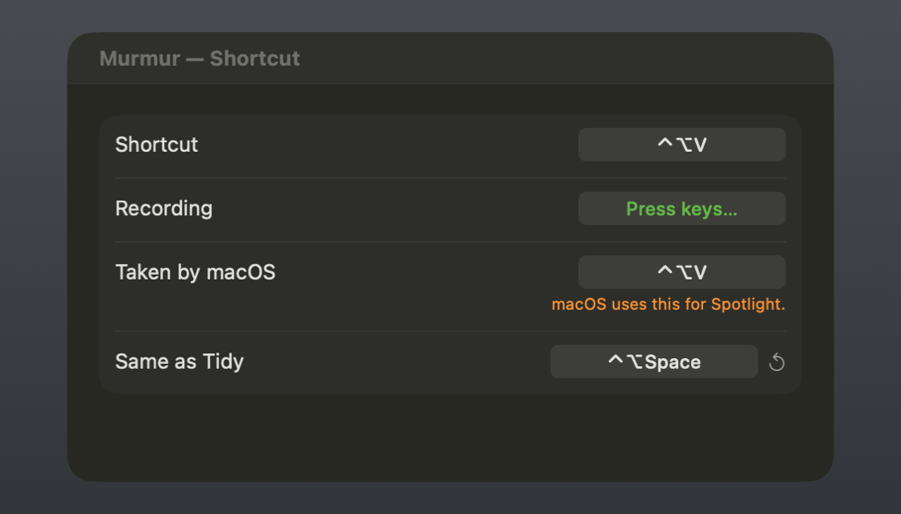
</p>

## Install

> [!IMPORTANT]
> **First launch only.** Murmur isn't notarized by Apple, so macOS blocks it the first time you open it.
> Click **Done**, open **System Settings → Privacy & Security**, scroll down, click **Open Anyway**
> next to "Murmur", then open it again. You do this once; updates install and open normally.

1. [Download Murmur.dmg](https://github.com/0-LY/murmur/releases/latest/download/Murmur.dmg) and open it.
2. Drag **Murmur** onto the **Applications** folder in the window that opens.
3. Open Murmur from Applications and use **Open Anyway** as above.
4. **First launch:** a short setup asks for the **Microphone** (to hear you), lets you pick it, check the room and say one
   test sentence, asks for **Accessibility** (for the talk key and to type where your cursor is), offers to download Parakeet Ultra,
   lets you choose how words appear, and lets you pick your talk key — with a little confetti at the end.
   Skipped it? Everything from setup is also in Settings. Run it again with **Run Setup Again** in Settings → General
   or **Set Up Murmur…** in the menu — your current settings are kept.

Without Accessibility, Murmur still works: the text goes to the clipboard and you paste it yourself.

To start Murmur automatically, turn on **Open at login** in Settings → General. It's off until you turn it on.

Requirements: macOS 26 or later on Apple silicon. Smart cleanup uses Apple Intelligence when it's on; without it,
Murmur uses Quick cleanup.

<p align="center">
  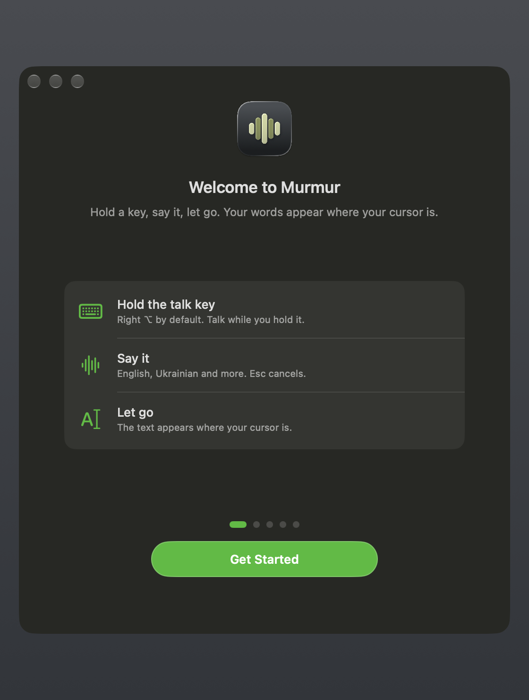
  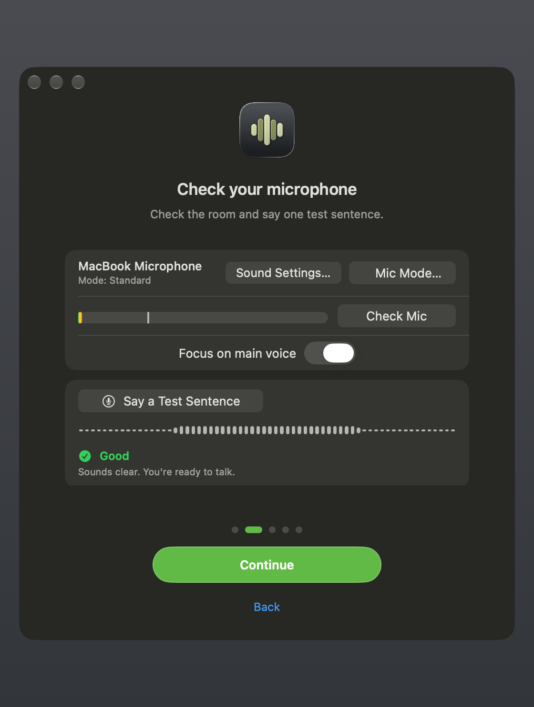
  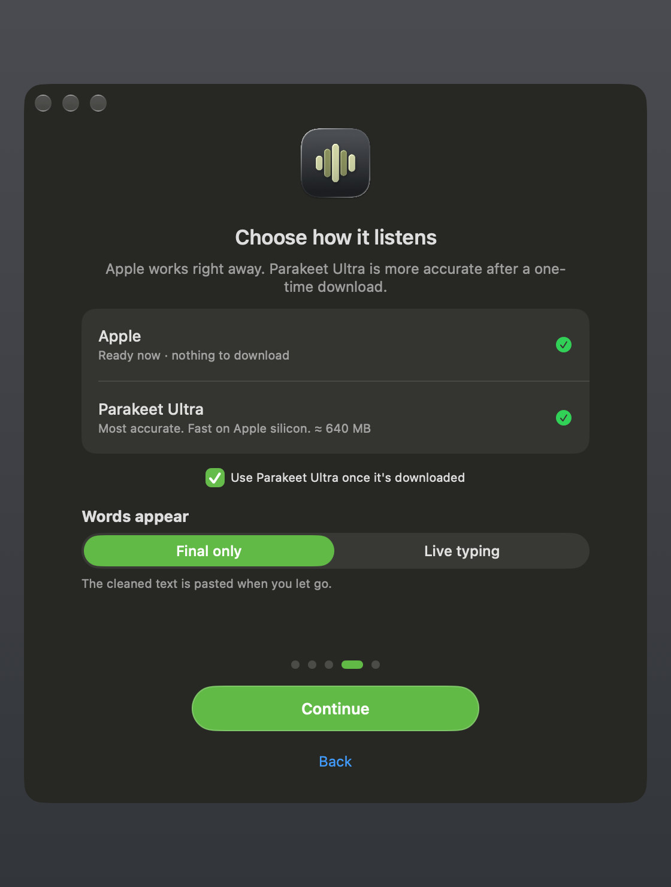
  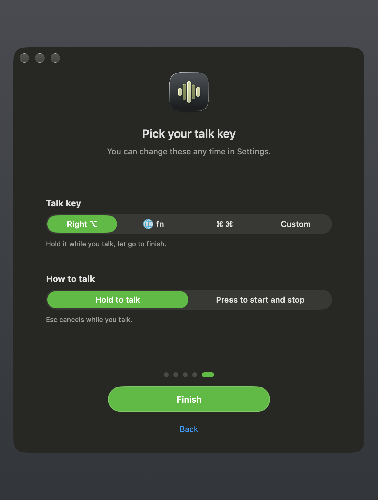
</p>

## Privacy

- Your voice never leaves your Mac. All four models run on this Mac; there is no account, no analytics, no tracking.
- Murmur listens only while you hold the talk key (or between your two presses), and when you click
  **Check Mic**, **Mic Mode…** or **Test Recording** yourself. The level meter stops when you leave the Microphone pane.
- The recording is kept in a private temporary folder (readable only by you) just long enough to turn it into text,
  then deleted. Leftovers are removed when Murmur starts and quits.
- Transcribed text isn't logged or stored. It's typed into your app through the clipboard, which Murmur marks as
  temporary and puts back the way it was, unless you choose to keep the text there.
- Downloaded models are saved in `~/Library/Application Support/Murmur/Models/` and come from Hugging Face over HTTPS.
  Downloads resume where they stopped; each file is checked while downloading, and Murmur records a SHA-256 of every
  model file so a reused copy is only accepted when it matches.
- To reuse a model another app already downloaded, Murmur only looks in `~/Library/Application Support/FluidAudio/Models`
  and `~/.cache/huggingface/hub`, reads nothing else, and never changes those files.
- **Focus on main voice** compares the voices inside each recording only; it keeps no voice print and saves nothing about
  how you sound. The speaker model lives in `~/Library/Application Support/Murmur/Voice/`.
- Settings live in `~/.config/murmur/`, readable only by you.
- The only other network requests are model downloads you start and the update check (`https://github.com/0-LY/murmur/releases/latest/download/appcast.xml`). No system profile is sent.

## Updates

Murmur updates itself. Every update is signed, and Murmur refuses any download whose signature doesn't match the key built into the app.

In **Settings → General** you can turn automatic checks off, check now, or switch on **Get beta updates** to try new features early.

## Build from source

```sh
git clone https://github.com/0-LY/murmur.git
cd murmur
./build.sh                # installs to ~/Applications
./build.sh /Applications  # or another folder
```

You need the Xcode Command Line Tools (`xcode-select --install`). The build uses Swift Package Manager; the first build
downloads FluidAudio, WhisperKit and Sparkle (pinned versions).

| Path | Purpose |
|---|---|
| `Sources/Murmur/main.swift` | App, menus, menu bar icon |
| `Sources/Murmur/Dictation.swift` | Talk key → recording → model → cleanup → text |
| `Sources/Murmur/Stream.swift` | Transcribing finished pieces while you talk |
| `Sources/Murmur/Live.swift` | Live typing: streaming results, stable-word commits, typing |
| `Sources/Murmur/SpokenPunctuation.swift` | Spoken punctuation commands (English and Ukrainian) |
| `Sources/Murmur/TalkKeys.swift`, `Hotkey.swift` | Right ⌥ / 🌐 fn / double-tap ⌘ and shortcut hotkeys |
| `Sources/Murmur/ShortcutRecorder.swift` | Reusable shortcut recorder |
| `Sources/Murmur/Sounds.swift`, `Resources/Sounds/` | Start and stop sounds (made by `scripts/make-sounds.swift`) |
| `Sources/Murmur/Engines.swift` | Apple, Parakeet and Whisper speech models |
| `Sources/Murmur/Models.swift` | Model downloads, storage, reuse and checksums |
| `Sources/Murmur/Audio.swift` | Microphone capture and private temporary audio |
| `Sources/Murmur/Mic.swift`, `MicPane.swift` | Microphones, speech gate, quality check, Microphone pane |
| `Sources/Murmur/Speaker.swift` | Focus on main voice: voice pieces, clustering, speaker model download |
| `Sources/Murmur/HUD.swift` | The glass bubble and its animation |
| `Sources/Murmur/Cleanup.swift` | On-device cleanup and vocabulary |
| `Sources/Murmur/Insert.swift` | Typing the text into the app you're in |
| `Sources/Murmur/Settings.swift`, `Setup.swift` | Settings window and first-launch setup |
| `Sources/Murmur/Migration.swift` | Moves settings and models after a rename |
| `Package.swift` | Dependencies (exact versions) |
| `Resources/` | Info.plist template and entitlements |
| `app.env` | Name, publisher, GitHub owner and repo, version |
| `scripts/` | Build and Sparkle download scripts; `scripts/icon/` makes the app icon |

## Credits

- Speech: [NVIDIA Parakeet TDT 0.6B v3](https://huggingface.co/nvidia/parakeet-tdt-0.6b-v3) (CC-BY-4.0), with the Ultra and Redux
  post-trainings by Moondream, run through [FluidAudio](https://github.com/FluidInference/FluidAudio) (Apache-2.0).
- Speech: [OpenAI Whisper large-v3-turbo](https://github.com/openai/whisper) (MIT), Core ML build by Argmax, run through
  [WhisperKit](https://github.com/argmaxinc/WhisperKit) (MIT).
- Speaker model for Focus on main voice: [CAM++](https://github.com/modelscope/FunASR) from FunASR (FunASR model license),
  Core ML conversion by FluidInference, run through FluidAudio.
- Apple Speech framework and Foundation Models for the built-in model and cleanup.
- Updates: [Sparkle](https://sparkle-project.org) (MIT).

## License

[MIT](LICENSE) © 0-LY
